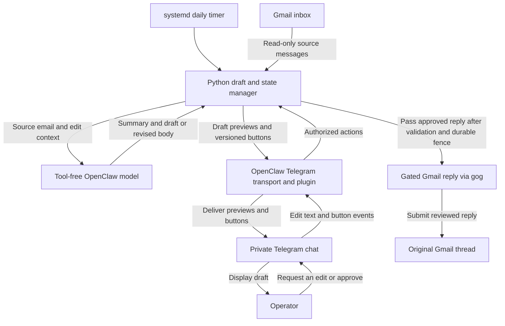

# Email Agent

Email Agent helps an operator keep up with a recurring Gmail sender without composing every reply from scratch. A Python daily digest prepares one summary and reply draft per new message, then lets the operator request edits and approve the current draft in a private Telegram chat.

## What the demo shows

The demo follows one fictional email through a draft revision. Approving the old draft, approving the revision, and repeating that approval produce simulated send counts of **0 → 1 → 1**. The outbox contains one copy of the revised reply.

<!-- Demo recording link slot. -->

## Offline quick start

With Python 3.11 or newer, run from the repository root in a Linux or WSL shell.

```sh
python3 scripts/demo_daily_sender_digest.py
```

Use this command from the repository root in Windows PowerShell with Ubuntu installed in WSL.

```powershell
wsl -d Ubuntu -- python3 scripts/demo_daily_sender_digest.py
```

The demo uses the Python standard library. It needs no package install, network connection, account, or API key. It exits with a nonzero status if a check fails.

1. Read one sample email and display the first reply draft.
2. Submit a scripted edit and display the revised draft. Replay the original approval button and verify that the simulated send count stays at **0**.
3. Replay the revised approval button twice. Verify that the counts are **1** and **1** and that the simulated outbox contains the revised reply.

### What the demo simulates

| Integration | Offline substitute |
| --- | --- |
| Gmail inbox | One fictional email in a local fixture with Gmail-shaped fields |
| Model | Canned initial and revised text for the sample email and edit instruction |
| Telegram | Captured notification views and scripted operator events using their button payloads |
| Gmail send | An in-memory outbox that counts calls to the send adapter |

The demo runs the daily digest's state manager with real file locking, state transitions, draft validation and approval handling. Each run creates fresh state in a temporary Linux directory and removes it on exit. [Python state manager](scripts/daily_sender_digest.py) · [Demo fixtures and assertions](scripts/demo_daily_sender_digest.py)

## How the daily digest works

The supplied systemd timer schedules the digest for 07:00 Asia/Bangkok. Python reads Gmail with a read-only credential, verifies the configured sender and keeps track of messages already reported. A separate OpenClaw profile with all model tools denied produces a summary and draft body, or just the revised body after an edit request. Python validates the output and binds the draft to the Gmail account, source message, thread and recipient. The model has no access to the send path.



- **Approval follows the version.** The first draft is v1. When an edit instruction is accepted, Python rotates the action tokens before calling the model. A successful revision changes only the body, increments the version and returns the draft for review. A failed revision keeps the prior text and version with fresh controls. Old approval buttons stay stale.
- **The send fence survives restarts.** Under the state lock, a current, unexpired approval for a draft awaiting review triggers a fresh check of the Gmail account and source binding. The manager persists `send_uncertain` before invoking the gated reply script. On confirmed success it records `sent`, and replaying the approval returns that status without another dispatch.
- **Uncertain outcomes require manual reconciliation.** A timeout, crash or failed success checkpoint can leave Gmail delivery ambiguous. The fence prevents automatic retry. The operator checks Gmail Sent and the original thread to resolve the outcome. [Digest implementation](scripts/daily_sender_digest.py) · [Send boundary](scripts/send_gmail_reply.py) · [Recovery runbook](docs/daily-sender-digest.md#recovery-and-evidence)

The scheduled digest is the main workflow. Gmail Watch/Pub/Sub, reply suggestions and label approval are optional integrations. A live installation uses a Linux systemd host, private OpenClaw Telegram routing, a tool-free model profile, separate Gmail reader and send credentials, and durable state. [Portfolio status](docs/PROJECT_STATUS.md) · [Systemd templates](deploy/systemd/README.md) · [Daily digest setup](docs/daily-sender-digest.md)

## Held-out drafting evaluation

The archive contains **60 real model responses to 30 synthetic held-out emails (15 Vietnamese, 15 English)**. Each of the two prompts, baseline and candidate, ran once per email in a fresh tool-free OpenClaw session using `openai/gpt-6-astra`. A single AI reviewer scored the paired answers blind and locked the grades before the prompt assignments were revealed.

| Locked metric | Baseline | Candidate |
| --- | ---: | ---: |
| Valid summary and draft (all responses) | 30/30 | 30/30 |
| Summary kept all marked facts and draft respected them (all responses) | 27/30 | 28/30 |
| Unsupported commitment (valid drafts only) | 0/30 | 0/30 |
| Draft needed a meaningful edit (all responses) | 2/30 | 2/30 |

The candidate scored one case higher on factual fidelity. With synthetic inputs, one generation per prompt per case and one AI grader, the scores describe this run only. In test-04, the blind packet omitted the Date header that supported the candidate's interpretation of “tomorrow.” The reviewer marked the candidate draft as needing an edit, and the table retains that locked grade. [Original archive, model answers and locked grades](evals/results/heldout-a3160ef/README.md)

From the repository root in a Linux or WSL shell with Python 3.11 or newer, reproduce the table from the archive without a model call.

```sh
python3 scripts/evaluate_daily_drafts.py report --run-dir evals/results/heldout-a3160ef
```

The evaluation guide covers offline dataset validation, fresh comparisons with an authenticated tool-free OpenClaw profile, and blind grading. [Evaluation guide](evals/README.md)

## Run the HTTP demo with Docker

The FastAPI demo runs the same draft flow for one fictional inbox message and one canned revision. It uses a simulated outbox and needs no accounts, credentials, or external services at runtime. The API has no authentication and the commands below publish it on localhost. Each container start resets the draft and outbox.

From the repository root in a clean checkout, build and start the image with Docker in Linux container mode. The build downloads the base image and Python packages.

```sh
docker build -t email-agent-draft-demo .
docker run --rm -p 127.0.0.1:8000:8000 email-agent-draft-demo
```

Once Uvicorn reports startup complete, run these requests in a second Linux or WSL shell with `curl` and `jq` installed.

```sh
base=http://127.0.0.1:8000
draft=$(curl -fsS -X POST "$base/draft")
original_approval=$(printf '%s\n' "$draft" | jq -er '.approval_token')
edit_token=$(printf '%s\n' "$draft" | jq -er '.edit_token')

revised=$(curl -fsS -X POST "$base/draft/edit" \
  -H 'Content-Type: application/json' \
  -d "{\"edit_token\":\"$edit_token\",\"instruction\":\"Make the reply shorter.\"}")
revised_approval=$(printf '%s\n' "$revised" | jq -er '.approval_token')
printf '%s\n' "$draft" "$revised" | jq '{version, reply: .draft.draft_body}'

for token in "$original_approval" "$revised_approval" "$revised_approval"; do
  curl -fsS -X POST "$base/draft/approve" \
    -H 'Content-Type: application/json' -d "{\"approval_token\":\"$token\"}" | jq -c .
done

curl -fsS "$base/outbox" | jq '{simulated_send_count, replies: [.messages[].draft_body]}'
```

Expect these three approval responses in order.

```jsonl
{"status":"stale","simulated_send_count":0}
{"status":"sent","simulated_send_count":1}
{"status":"sent","simulated_send_count":1}
```

The outbox response contains one reply, `Hi Maya, thanks for the slides. I received them.` Stop the container with Ctrl+C.

The Windows demo guide covers local Uvicorn setup and the stepped PowerShell demo. [Windows demo guide](docs/recording-demo-windows.md)

## Verification

Use Python 3.11 or newer and Node.js 22 or newer for the regression suites. Run from the repository root in a Linux or WSL shell. Verified on Ubuntu 26.04.1 LTS under WSL 2 with Python 3.14.4 and Node.js 24.21.0.

```sh
python3 -m unittest discover -s tests -p 'test_*.py'
node --test tests/*.test.mjs
```
