# Realtime Gmail events and Telegram notification outbox

This optional workflow reads Gmail history through Cloud Pub/Sub, prepares a local notification and delivers it through OpenClaw. Reply and label actions are separately enabled and require explicit approval. [Reply approval](telegram-reply-approval.md) · [Label approval](gmail-label-approval.md)

```mermaid
flowchart LR
    G[Gmail Watch] --> P[Google Cloud Pub/Sub]
    P --> S[StreamingPull subscriber]
    S --> H[Gmail history.list: messagesAdded]
    H --> Q[Durable queue: message IDs]
    Q --> F[Gmail messages.get]
    F --> N[Normalize and exclude SENT / DRAFT]
    N --> A[Optional OpenClaw summary]
    A --> O[Durable JSON outbox]
    O --> T[OpenClaw Telegram notification]
```



## Boundaries and contracts

- `scripts/new_email_pipeline.py`: `NewEmailEvent(message_id, history_id=None)`,
  normalization, queue, deduplication and local outbox. A future event backend
  calls `Pipeline.enqueue(event)` under the same lock; Gmail fetch uses the ID.
- `scripts/realtime_email_adapters.py`: Gmail REST, optional OpenClaw summary and
  Telegram dispatch adapters. Gmail operations are GET profile/history/messages
  and POST watch only. Telegram uses the existing OpenClaw channel configuration.
- `scripts/run_realtime_email_agent.py`: registration, renewal, Pub/Sub subscriber
  and explicit retry entrypoints. The SDK uses **StreamingPull**, automatically
  managing delivery leases. No public HTTP endpoint or Gmail polling loop exists.
- The existing sender reader, 07:00 runner, skill and daily service remain intact.
  The new runner does not filter by `TARGET_SENDER` or enable Gmail dispatch via
  `EMAIL_AGENT_AUTO_SEND`. Reused helpers supply strict JSON parsing, external
  paths, atomic state replacement, directory fsync, Linux flock and model guards.

Gmail's Pub/Sub notification supplies an account and `historyId`, not the email.
The SDK supplies decoded bytes; its transport message ID is **not** a Gmail ID.
The subscriber verifies the account and resolves all `messagesAdded` from the
persisted cursor using every page of `history.list`. Only the final successful
page advances the cursor; cursor and pending IDs are persisted together before
ACK. Out-of-order/duplicate notifications cannot move the cursor backwards.
`historyId` accepts positive integers (exact `int`, never `bool`) and ASCII
numeric strings matching `[1-9][0-9]*`. Notification decoding validates first,
then converts to string without a float conversion. Zero, negatives, booleans,
floats, missing IDs and malformed strings are rejected.

The watch covers the whole mailbox, including received mail that existing Gmail
filters auto-archive. Only message additions are candidates, not read/unread or
label changes. Fetch excludes messages currently labeled `SENT` or `DRAFT` even
if they also carry `INBOX`. It does not rely on the From header to detect sending
(aliases exist). Existing spam/trash are not scanned, but new received additions
there are eligible. Missing/malformed labels fail closed. Permanently deleted
messages remain retryable for operator review; they are never claimed processed.

Normalized in-memory email has exactly:
`message_id`, `thread_id`, `from`, `to`, `subject`, `date`, `body`.
MIME plain text is preferred; HTML-only content becomes inert text with scripts
and styles omitted. Attachments are not downloaded and links/images are not
opened. Unsupported non-UTF-8 characters use replacement decoding; date remains
the original header. No sender filter is applied.

Payload contract (one JSON file per Gmail message):

```json
{
  "event": "new_email",
  "message_id": "abc123",
  "from": "someone@example.org",
  "subject": "Meeting",
  "date": "",
  "summary": ""
}
```

Existing five-field payloads without `date` remain readable.

`EMAIL_AGENT_SUMMARY_MODE=none` is the default and produces an empty summary.
`openclaw` enables the existing local agent/9Router configuration. The adapter
requires the existing separate deny-all-tools and silent-log config, a fresh
session and an anonymous prompt file. All email fields are untrusted data, not
instructions. Model failures do not fall back to marking an event complete.

## Persistence and recovery

Default external location: `~/.local/state/email-agent/realtime/`, or
`$XDG_STATE_HOME/email-agent/realtime/`. Use a durable Linux local filesystem.
The directory is 0700 and files are 0600. Never use the repo or temporary storage.

- `state.json`: schema version, account hash, history cursor, watch expiration
  (Unix milliseconds), and ID statuses `pending`, `retryable`, `processed`,
  `ignored`. No body, subject, address, summary, credentials or raw errors.
- `outbox/<message_id>.json`: separately stored notification artifact containing
  sender, subject and optional summary. It is private email-derived data; do not
  commit it or print it to the journal. Raw normalized bodies are not persisted.
- `outbox/<message_id>.notifying`: durable intent written before Telegram dispatch.
- `outbox/<message_id>.notified`: durable success marker written after the CLI
  succeeds; it also recognizes the markers created by the runtime implementation.
- `pipeline.lock`: one writer across processes; thread mutex serializes SDK
  callbacks and worker. Locks are released between background message jobs.

Fetch/model/outbox failure leaves a retryable ID. The subscriber retries queued
work after startup and between 30-second waits; these waits do not discover new
mail by polling Gmail. `retry-pending` also drains the durable queue without a
Pub/Sub event. A successful atomic outbox write and fsync precedes dispatch. An
existing payload without a send intent is dispatched without repeating the model.
Telegram CLI success and a durable `.notified` marker precede `processed`.
If state persistence fails after that marker, recovery does not send again.
Retain both state and outbox across upgrades; do not delete payloads to retry them.

Timeout/crash/dispatch error after `.notifying` is uncertain: the ID remains
`retryable`, but that fence blocks automatic resend. Reconcile with Telegram
privately while the subscriber is stopped and the state lock is held. If delivery
is confirmed, persist `.notified` through `Store.mark_notification_sent`; if
non-delivery is proven, an operator may remove only that ID's `.notifying` marker
and retry. Do not reset account state or clear all markers. This favors avoiding
duplicates over automatic retry of ambiguous sends and does not promise exactly
once remote delivery. Processed legacy outbox records without `.notified` require
manual reconciliation; they are not automatically backfilled.

`TELEGRAM_TARGET_CHAT_ID` is mandatory for subscribe/retry and must be a numeric
chat ID (negative group IDs are accepted). There is no built-in recipient. The
transport uses `openclaw message send --channel telegram` with captured output,
outside the model turn. Email data cannot select the target or invoke tools.
The safe summary config/state overrides are removed only for this transport so
OpenClaw can use its existing private Telegram channel configuration. Bot tokens
must remain there; no new bot token is needed in the repo. Gmail/ADC environment
values are removed from the transport child. Rendered notification text is passed
via the supported CLI message argument, so local process inspection can see it;
child output is captured, not forwarded to the journal. Oversized or otherwise
rejected transport messages require the same manual reconciliation after failure.

Malformed state/account mismatch stops without reset. Malformed Pub/Sub data or
failed history persistence is NACKed with a fixed status; configure subscription
retry backoff to avoid poison-message loops. No raw event/error is logged.
Heuristic redaction covers common credentials and known secret environment or
Gmail credential values before model input and payload persistence. It cannot
identify every unknown secret someone might include in an email. Dedicated
OpenClaw session storage may contain email-derived input/output and must also
stay outside Git with private permissions, as in the existing model runbook.

Initial registration records profile history **before** calling watch. It starts
from that point, not a historical inbox import. Renewal never resets this cursor.
The separate daily timer renews watch and catches up history; startup also catches
up. This catches missed push notifications without continuous Gmail polling.
Google recommends daily renewal and requires renewal within seven days; see the
[Gmail push guide](https://developers.google.com/workspace/gmail/api/guides/push).
Monitor timer success and `watch_expiration`; sleeping/offline WSL cannot renew.

An expired history cursor (HTTP 404) raises
`history_expired_manual_resync_required`. Watch may renew, but the old cursor is
retained and no gap is silently skipped. Stop the subscriber and arrange an
operator-reviewed full read-only sync: snapshot current profile history, enumerate
retained received message IDs with pagination, preserve all processed/ignored IDs,
durably enqueue missing IDs, then reconcile history from the snapshot before
resuming. Do not delete state or simply replace its cursor with the latest watch
response. A full-sync command is outside this task; use the official
[history/sync contract](https://developers.google.com/workspace/gmail/api/reference/rest/v1/users.history/list).
Recovery cannot reconstruct mail permanently deleted while the agent was offline.

## Manual Google Cloud and credential setup

1. Select the project owning the **existing Gmail OAuth client**. Enable Gmail
   API and Cloud Pub/Sub API. The watch topic's project must match that OAuth
   project's ID; environment validation alone cannot prove client ownership.
2. Create a topic and a **pull** subscription before registering watch. Grant
   `roles/pubsub.publisher` on this topic to
   `gmail-api-push@system.gserviceaccount.com`. Handle any organization domain
   restriction explicitly. Configure retention for expected downtime and retry
   backoff (for example minimum 10 seconds, maximum 600 seconds).
3. Configure separate Application Default Credentials (ADC) for the subscriber
   identity. Grant `roles/pubsub.subscriber` on that subscription. This is Cloud
   IAM access, not a broader Gmail OAuth grant. Prefer an existing workload/user
   ADC setup; do not commit service-account keys. Follow Google's
   [pull subscriber setup](https://docs.cloud.google.com/pubsub/docs/pull-messages).
4. The Gmail adapter uses `google-auth` directly rather than assuming undocumented
   gog watch/history/export syntax. Prepare a protected standard Google
   `authorized_user` JSON file from the existing operator-managed read-send grant:
   `type`, `client_id`, `client_secret`, `refresh_token`, and `scopes` (list).
   Verify local gog auth/export help if using gog to obtain it; export is not run
   by this code. Supply values locally without printing or placing them in Git.
   A raw gog token export may require conversion to this format. Preserve the
   original granted-scope metadata; do not claim scopes absent from that grant.
5. Allowed Gmail scope metadata is `gmail.readonly` and optionally `gmail.send`,
   plus standard identity scopes. The adapter requests only the already granted
   `gmail.readonly` when refreshing. It rejects full/modify/settings scopes and
   does not perform an OAuth consent flow. File must be outside Git and 0600.
   See [Google authorized-user credentials](https://google-auth.readthedocs.io/en/latest/reference/google.oauth2.credentials.html).

Copy `deploy/systemd/email-agent-realtime.env.example` to
`~/.config/email-agent/realtime.env` (0600; parent 0700), then fill privately:

| Variable | Value |
| --- | --- |
| `GOG_ACCOUNT` | Actual Gmail account email, not a gog alias; checked against profile |
| `GCP_PROJECT_ID` | OAuth project's ID |
| `GMAIL_PUBSUB_TOPIC` | Full `projects/<project>/topics/<topic>` name |
| `GMAIL_PUBSUB_SUBSCRIPTION` | Full `projects/<project>/subscriptions/<subscription>` name |
| `GMAIL_AUTHORIZED_USER_FILE` | Absolute private Gmail credential file path |
| `GOOGLE_APPLICATION_CREDENTIALS` | Optional ADC file path, if not using default ADC |
| `EMAIL_AGENT_SUMMARY_MODE` | `none` initially; `openclaw` after model preflight |
| `TELEGRAM_TARGET_CHAT_ID` | Explicit numeric recipient chat ID; no default |

Use the existing private OpenClaw Telegram bot configuration. EnvironmentFile
does not expand `~` or `$HOME`.

## Realtime setup and verification

1. Use an isolated Linux environment and test mailbox for integration checks. Pause competing timers and preserve existing durable state before making deployment changes.
2. Run the [offline regression suites](../README.md#verification).
3. Create a dedicated external venv, for example
   `python3 -m venv ~/.local/share/email-agent/realtime-venv`, then install with
   `~/.local/share/email-agent/realtime-venv/bin/pip install -r deploy/systemd/realtime-requirements.txt`.
   Complete the Cloud and private credential setup above. Keep summary mode
   `none` until event delivery, state and outbox have been verified.
4. Make local copies of `email-agent-subscriber.service`,
   `email-agent-watch-renew.service`, and `email-agent-watch-renew.timer` under
   `~/.config/systemd/user/`. Replace `@REPO_ROOT@` with the absolute checkout
   path and `@PYTHON@` with the external venv's absolute Python path. Run
   `systemd-analyze --user verify` on those copies, then
   `systemctl --user daemon-reload`. Do not enable them before configuration.
5. Register watch by starting `email-agent-watch-renew.service` once; first run
   initializes its baseline. Check `watch_renewed`, future expiration and cursor
   in the private state. Equivalent CLI with trusted environment loaded is
   `python scripts/run_realtime_email_agent.py register-watch`.
6. Start `email-agent-subscriber.service`. Send test emails **from separate test
   accounts manually**, including two different senders and an HTML-only message.
   Confirm one payload per received Gmail ID, `processed` states, expected sender
   and subject, and unchanged Gmail read/unread/labels/drafts/Sent. Review payloads
   privately, not via `journalctl` or shared logs.
7. Redeliver a recorded history notification, then restart the subscriber. Confirm
   payload file bytes/mtime do not change and there is no second notification.
   A notification containing history but no new message produces no payload.
   Verify SENT/DRAFT additions are `ignored` (use existing controlled fixtures;
   do not authorize this agent to create/send mail for the test).
8. On a **separate test subscription**, publish malformed notification data and
   observe NACK/fixed `event_retryable`, no payload and no cursor change. Restore
   or remove the test subscription afterwards.
9. Enable `openclaw` only after checking the existing private deny-all-tools,
   silent logging and separate session directory configuration. Submit a test
   email containing an instruction to execute a command; confirm a summary only,
   no tool/action, no email dispatch. Temporarily use an invalid model config to
   force failure: ID stays `retryable`, no payload. Restore config and restart;
   verify it becomes processed without needing a fresh Pub/Sub event.
10. For fetch failure, queue a synthetic nonexistent hex ID through the event
    abstraction **in isolated test state**, run `retry-pending`, and verify it is
    retryable. Corrupt a copy of that state to verify fail-safe startup, then
    restore the intact copy.
11. Start renewal again and confirm existing queued/processed IDs survive. Check
    journal contains fixed status strings only, never bodies or credentials.
    Enable the new subscriber and renewal timer after these checks:
    `systemctl --user enable --now email-agent-subscriber.service email-agent-watch-renew.timer`.
    Confirm the timers with `systemctl --user list-timers`. User lingering and network availability are needed for unattended runs.

Unit tests mock Gmail, Pub/Sub and the model. They verify local durability and
failure behavior; they do not prove live OAuth/topic IAM, delivery latency,
OpenClaw output compatibility or remote Telegram delivery guarantees.
