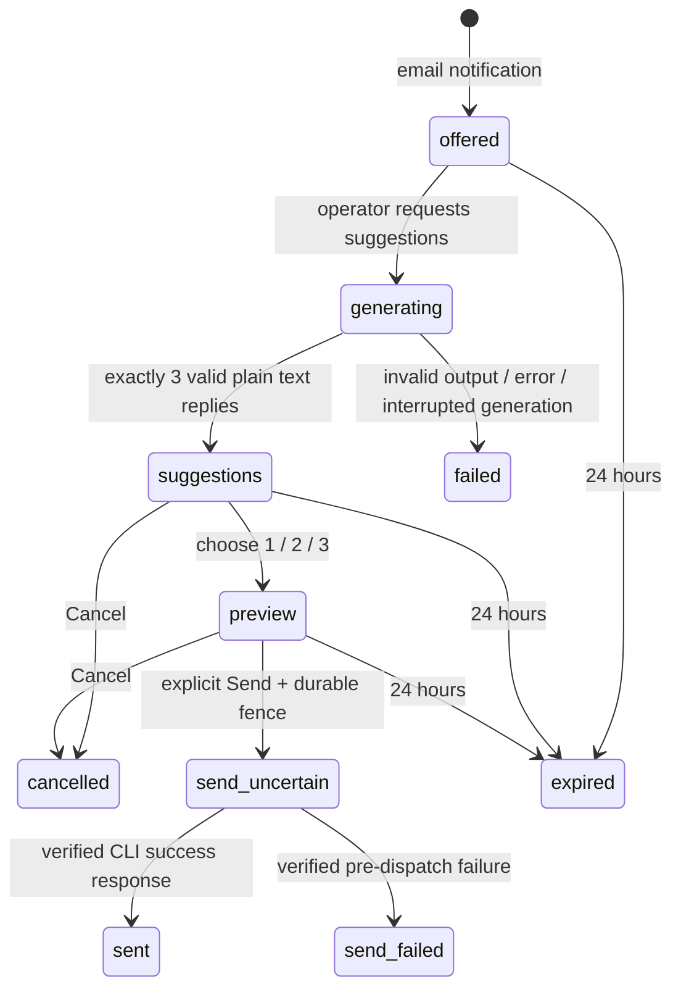

# Telegram reply suggestions and explicit approval

The optional realtime reply workflow prepares suggestions on request and presents a preview before an explicit send approval. Keep `EMAIL_AGENT_AUTO_SEND=false`. [Realtime architecture](realtime-email-architecture.md)

## OpenClaw integration

The plugin uses these **OpenClaw 2026.9.5** interfaces.

- `openclaw message send --help` exposes `--presentation`. Its `buttons` blocks
  accept `{label, action: {type: "callback", value}}`.
- Local `docs/channels/telegram/rich-messages.md` documents inline buttons and
  registered plugin interactive handlers. Local SDK types in
  `dist/interactive-dispatch-CkNNFZsE.d.ts` expose the Telegram context and response
  functions. The installed callback router in
  `dist/telegram-ingress-drain-factory-DbVZxBjw.mjs` supplies authenticated sender,
  chat and account metadata before considering agent fallback.
- `api.registerInteractiveHandler({channel: "telegram", namespace: "emailreply",
  handler})` claims `emailreply:<opaque-id>`. The handler always returns
  `{handled: true}`, including authorization, worker and delivery failures. It
  never returns `submitText` or asks an agent to interpret callbacks.
- `ctx.respond.editMessage({text, buttons})` uses plain text Telegram editing;
  buttons use rows of `{text, callback_data}`. No bot token enters this plugin or
  its worker. OpenClaw remains the **only Telegram update consumer**. No additional
  `getUpdates`, webhook, gateway patch or text command UX is introduced.

Recheck native callback support before changing the pinned OpenClaw version.

## Flow and security boundaries

TASK-012 notification delivery and its existing optional summary are preserved.
With `EMAIL_AGENT_REPLY_APPROVAL=true`, the notification adds **💬 Gợi ý trả lời**.
Creating this action stores identifiers only; it neither reads the email again
nor calls the suggestion model. Summary mode remains independently configurable.

Only a real callback from the configured private operator can advance the flow.
Both the plugin and Python state machine check Telegram authorization, channel,
bot account, user and chat. `TELEGRAM_TARGET_CHAT_ID` must be the positive private
chat ID equal to `TELEGRAM_APPROVER_USER_ID`; groups, forums and topics are denied.
Names/usernames and the callback's displayed message text are never authorities.
Existing TASK-012 group notifications still work with approval disabled.



`send_uncertain` is terminal for all subsequent callbacks. Only the original
in-flight invocation may replace its own fence with the observed outcome.
Cancellation, expiry, generation failure, send failure and sent are also terminal.
Old buttons may redisplay current state; they cannot re-arm or repeat work.

On request, Gmail is fetched by the recorded message ID and the account profile
is checked. From, Reply-To, original thread and subject are validated through
`send_gmail_reply.py`. The model sees explicitly untrusted, redacted data with a
32,000-character body cap. Existing `model_environment()` requires the separate
strict JSON config with `tools.deny=["*"]` and silent logging; `--local` avoids a
stale gateway tool policy. No Gmail/Telegram/Google/GOG secret environment is
passed to the model process. There is one explicit model invocation per action;
duplicates and interrupted generation do not automatically regenerate.

The requested model contract is strict JSON with exactly `suggestions`, containing
exactly three nonempty plain text strings of at most 700 characters each. Duplicate
JSON keys, extra fields, invalid sizes/types, control/format characters, HTML,
code fences and detected secrets are rejected. The model never supplies recipient,
thread, message ID or subject. This is prompt-plus-validation, not a claim of
provider-enforced constrained decoding or perfect injection/content detection.

Selection shows **To**, **Subject**, the full reply, **✅ Gửi** and **❌ Hủy**.
Only the new opaque confirm token exposed in that preview can initiate sending.
Callback data contains a namespace and a random 128-bit ID, never email data,
recipient, model reply, credentials or a Gmail message ID.

Confirm persists/fsyncs `send_uncertain` before dispatch, then rechecks the account
and source. It invokes the existing `scripts/send_gmail_reply.py --send` with the
reviewed five-field object on stdin. That CLI independently re-fetches raw source
metadata immediately before `gog gmail reply`, pins message/thread/subject/From,
rejects Reply-To redirects and duplicate headers, and removes other source To/Cc/
Bcc addresses. No reply-all, attachments, alternate Gmail send path, draft, label,
OAuth expansion, TASK-014 work or change to the 07:00 workflow is introduced.

Nonzero/unknown send outcomes, timeout, malformed success output, process death,
or failure to save success leave terminal `send_uncertain` for manual review.
There is no send retry. A Telegram delivery error also never replays Gmail send.
The CLI's known validation/read error codes become terminal `send_failed`.

## Durable state and operations

State defaults to `~/.local/state/email-agent/realtime/interactions/state.json`
(or the existing `XDG_STATE_HOME` root), outside the repository. The directory is
0700; lock and atomic state files are 0600. Existing flock, tempfile, file fsync,
atomic replace and directory fsync helpers are reused. A single interaction lock
serializes state transitions. Notification action creation waits for an active
callback instead of losing a notification to lock contention; this may delay new
notifications while a suggestion model runs. The daily lock remains nonblocking.

State is bound to account/user/chat/bot account by a scope hash. A configuration
change cannot silently reuse old approvals. Raw email body is never stored in
interaction state. Pending suggestions and preview data are stored privately to
survive restart, then removed on terminal transitions. Expiry is checked at every
event and again before send; expired pending content is purged on the next state
operation. Terminal ID/token tombstones are retained to prevent duplicates.
Do not delete them to retry uncertain sends. The flat file is intended for this
single-operator workflow; automatic tombstone pruning is intentionally absent.

Worker stdout is a private captured pipe carrying UI text, **not a journal log**.
Stderr is discarded and errors are fixed text. No body, reply or secret is logged
by this feature. OpenClaw/provider transcript retention is a separate pre-existing
model-runtime concern; audit private model state permissions/retention before
enabling this feature. The anonymous prompt temporary file is closed after use.

For `send_uncertain`, manually inspect Gmail Sent and the original thread before
any operator-initiated recovery. No automatic recovery/retry command is provided.
If the process dies before a Telegram status can be delivered, a later click reads
the durable terminal state and reports manual review. Do not claim exactly-once
remote delivery or successful delivery merely from a local preview.

## Private setup

1. Install/link `deploy/openclaw/email-reply-approval` into the existing OpenClaw
   2026.9.5 gateway using the approved plugin deployment workflow. Preserve the
   repository layout. The plugin has no npm dependencies or startup network calls.
2. In private OpenClaw config, enable/allow plugin `email-reply-approval` and set
   its `environmentFile`, `workerPath`, and `pythonPath` to absolute Linux paths.
   `workerPath` points to this checkout's `scripts/run_telegram_reply_action.py`;
   `pythonPath` points to the existing environment with TASK-012 dependencies.
3. Copy `worker-environment.example.json` **outside Git**, fill required values
   privately, and chmod 0600 under a private directory. It is a strict JSON object
   of string environment values, not executable shell. It must belong to the
   gateway's OS user. Use the same account, IDs, bot account and state root as
   the subscriber. Optional existing keyring credentials (`GOG_KEYRING_PASSWORD`,
   `GOG_KEYRING_BACKEND`), `PATH`, and `XDG_STATE_HOME` are supported. Do not put a
   Telegram bot token in it. All actual IDs/credentials stay outside repo/docs/logs.
4. Preserve the existing isolated tool-denied/silent model config and state paths.
   Keep `EMAIL_AGENT_AUTO_SEND=false`. Use only already-authorized Gmail scopes.
5. Confirm the native handler registered successfully on the same Telegram bot
   account, and existing channel access policy authorizes only the private operator.
   Enable inline buttons for the private surface through the existing channel config.
   **Only then** set `EMAIL_AGENT_REPLY_APPROVAL=true` and the private approver ID
   in the subscriber environment. The repository example defaults this flag off.
6. Verify preview and confirmation, authorization, duplicate callbacks, restart behavior and uncertain sends with an isolated test configuration.

OpenClaw forwards unclaimed callback namespaces to its agent. Therefore keep this
plugin registered while any old buttons can be clicked, including after disabling
new notifications. The handler claims its namespace even with broken private
configuration. Removing/disabling the plugin requires disabling the affected
callback surface first; the Python worker alone cannot enforce gateway fallback.

## Offline verification

```bash
python3 -m unittest discover -s tests
node --test tests/telegram_reply_plugin.test.mjs
```

All service/model/send paths in tests use synthetic fixtures and mocks. Tests
cover authorization, no premature model/send, three-result schema, preview,
opaque callbacks, cancellation, expiry, concurrency, crash/disk-failure fences,
source/thread/recipient verification, CLI integration, uncertain outcomes,
restart persistence, secret/log hygiene and existing TASK-012 regressions.
